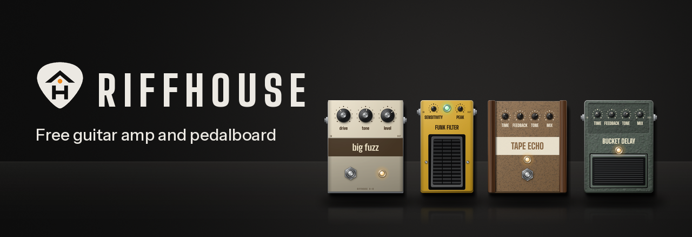
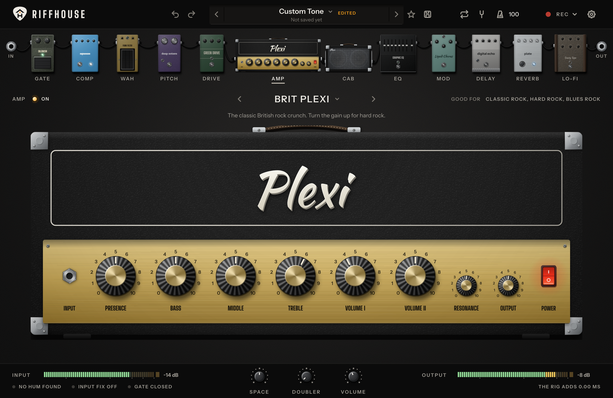
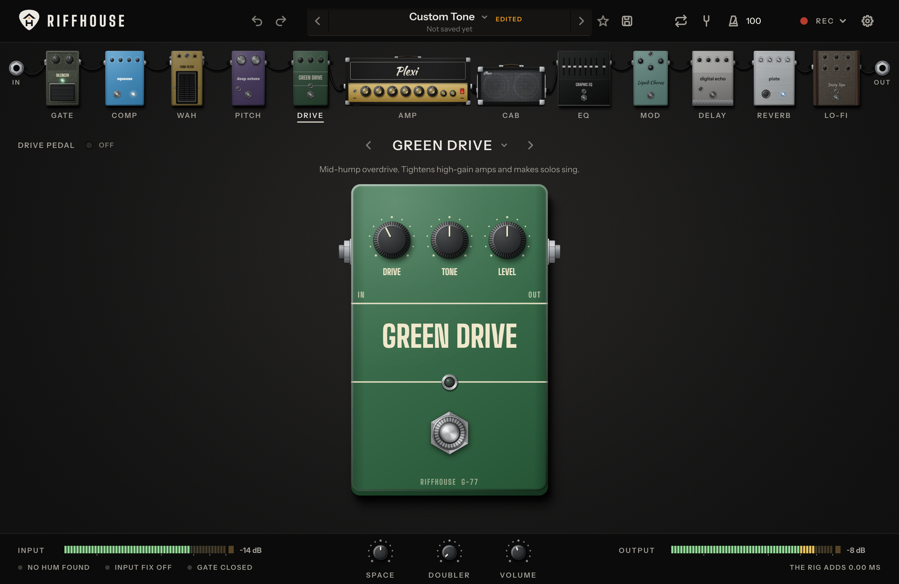
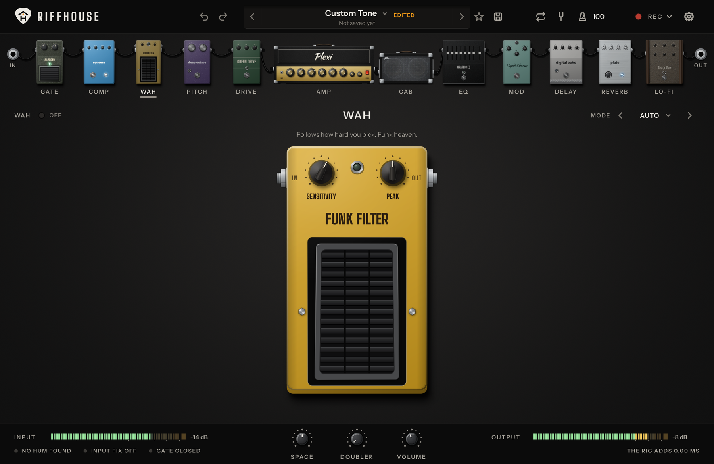
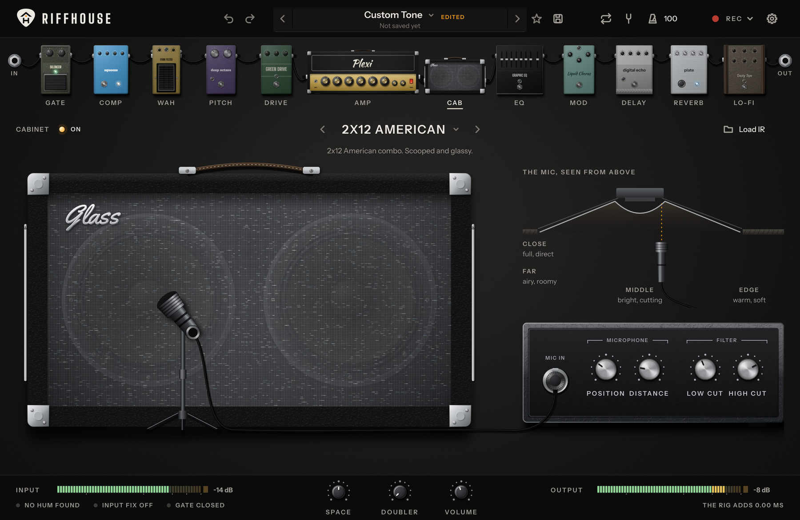
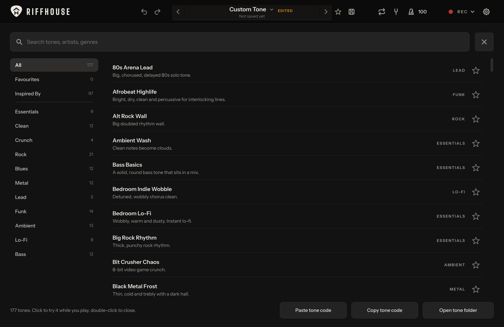
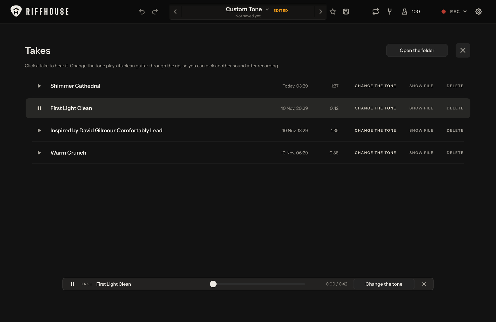
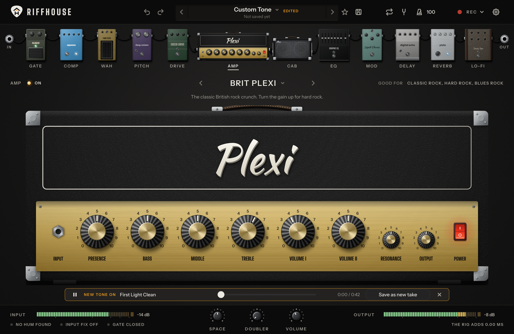
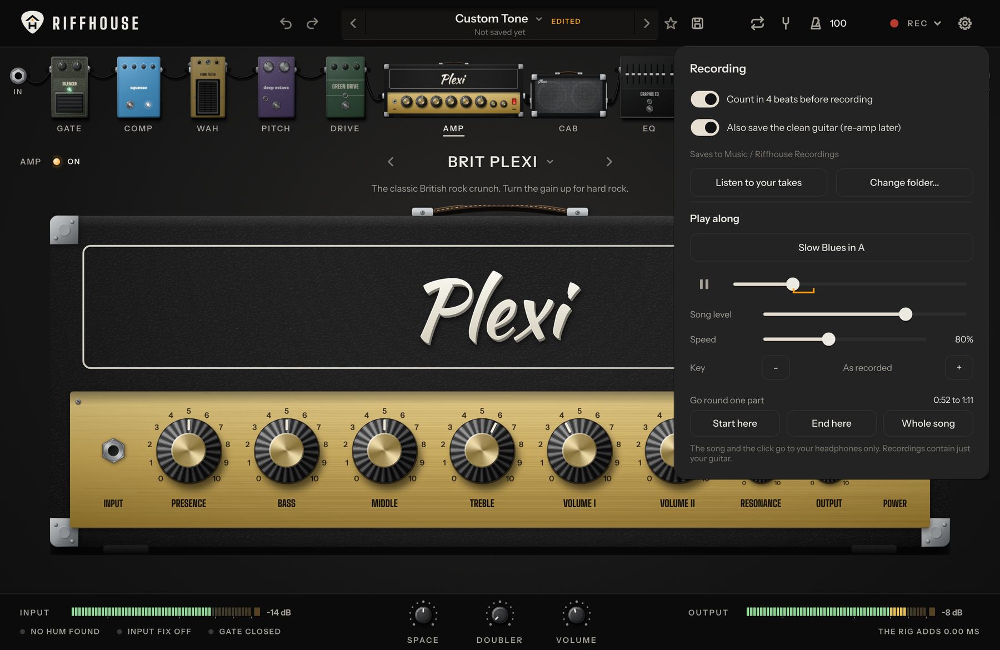
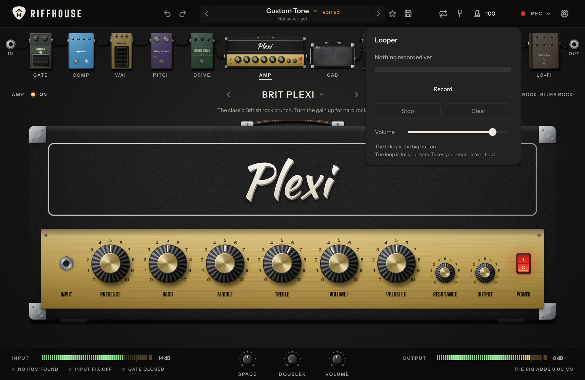

# Riffhouse

A free guitar amp and pedalboard for your computer.

Plug your guitar into whatever you have, even the mic jack on a laptop. Press one button, strum for twenty seconds, and play. No audio interface needed, no account, no ads.



## Get it

**Windows:** download the file ending in `windows-setup.exe` from the [latest release](https://github.com/NatikChhabra/riffhouse/releases/latest) and run it.

Windows may show a blue "Windows protected your PC" box the first time. That happens because the installer is not signed with a paid certificate. Press **More info**, then **Run anyway**.

After that Riffhouse keeps itself up to date. A new version downloads in the background, its SHA-256 is checked against the one GitHub publishes for the file, and it goes in when you close the app. It never interrupts you while you play or record, and it leaves your tones and settings alone. You can switch this off in Settings.

What changed in each version is in the [changelog](CHANGELOG.md). Every older version stays on the [releases page](https://github.com/NatikChhabra/riffhouse/releases), so you can go back: run the older installer over the newer one.

**macOS and Linux:** build from source for now (see below).

## What you get

- **11 amps**, from glassy cleans to tight metal, plus a bass amp and a direct channel.
- **9 speaker cabinets** with a mic you can move across the cone, and a slot for your own impulse response.
- **29 pedals:** gate, compressor, wah and envelope filter, octave, seven drives and fuzzes, graphic EQ, six modulations, four delays, six reverbs and a lo-fi box.
- **177 tones** sorted by genre, with "Inspired by" tones for well-known players and songs.
- **Neural captures:** load any `.nam` file as the amp.
- **Tuner** for any tuning, **metronome**, and a **recorder** that also keeps the clean guitar.
- **Takes:** press L to listen to what you recorded. Pick a take, turn the knobs or choose another tone while it plays, and save it as a new take. You played it once, you can re-amp it as often as you like.
- **Play along:** load a song, it plays in your headphones and stays out of your recording. Slow it down without changing its pitch, change its key without changing its speed, and mark one part to go round until you have it.
- **Looper:** press O to record a part, O again to let it go round, and again to add a layer.
- **Undo and redo** for the whole tone, with Ctrl+Z and Ctrl+Y.
- **Drop files on the window:** a `.nam` capture becomes the amp, an impulse response the cabinet, a song the backing track, a tone file the tone.
- A **VST3 plugin** of the same rig for recording software.

Every amp, pedal and cabinet is its own piece of gear, drawn by the app itself.

| | |
|---|---|
|  |  |
|  |  |

## Record, then change your mind

Every take is saved twice: once the way you heard it, once as the clean guitar. Press **L** for your takes. **Change the tone** plays the clean guitar through the rig, so you can turn knobs or pick another tone while your own playing loops, and save the result as a new take.

| | |
|---|---|
|  |  |

## Practise with the song

Load a song, or drop it on the window. It plays in your headphones and never ends up in a take. Slow it down to 50 percent and the pitch stays where it was. Move it up or down a few semitones and the speed stays where it was, which helps when the record is tuned half a step down and your guitar is not. Mark the start and the end of the hard part and it goes round until you have it.

The looper is for your own playing: press **O**, play a rhythm part, press **O** again and solo over it.

| | |
|---|---|
|  |  |

## It sets itself up

- It listens on every input while you strum and picks the one your guitar is on.
- It tries the fastest audio modes your computer has and keeps the lowest delay that runs without crackles.
- It sets the input level and the noise gate from what it hears.
- It finds 50 or 60 Hz mains hum and removes only that.
- **Input Fix** measures how much treble a mic jack takes away from a guitar and puts it back.
- Plug in late, pull the cable out, close the laptop lid: it reconnects by itself. If Windows swaps in another microphone, Riffhouse stays silent, because a laptop mic through an amp howls.

## What we measure

Every change runs 5,400 automatic checks on the sound engine before it ships.

| | |
|---|---|
| Delay added by the rig | 5 samples, about 0.1 ms at 48 kHz |
| Amp oversampling | 8x below 64 kHz, 4x above |
| Aliasing on a hot amp | 42.9 dB below the wanted harmonics |
| Everything switched on | about 8x faster than real time on one core of a build server |
| Loudness across all 177 tones | within 5 dB of each other |

## Build it yourself

You need CMake 3.22 or newer and a C++20 compiler. JUCE and the Neural Amp Modeler core are fetched for you.

```sh
cmake -S . -B build -DCMAKE_BUILD_TYPE=Release
cmake --build build --config Release --target Riffhouse_Standalone Riffhouse_VST3
```

On Linux install the usual JUCE packages first (ALSA, JACK, FreeType, Fontconfig, X11, Mesa). The list is in `.github/workflows/build.yml`.

On Windows, pass `-DRIFFHOUSE_ASIO_SDK_DIR=<path>` to build with ASIO. Without it you still get WASAPI exclusive mode.

Run the checks:

```sh
cmake --build build --config Release --target riffhouse_tests
build/tests/riffhouse_tests_artefacts/Release/riffhouse_tests
```

## Share tones

A tone is a small JSON file. In the tone browser, **Copy tone code** puts the current tone on your clipboard as text, and **Paste tone code** loads one. **Open tone folder** shows where your own tones live. To add a tone to the factory set, put it in `presets/` and open a pull request.

## Licence and names

Riffhouse is made by [Natik Chhabra](https://github.com/NatikChhabra). It is free software under the GNU Affero General Public License, version 3 or later.

It is built with [JUCE](https://juce.com) (AGPLv3), [Neural Amp Modeler Core](https://github.com/sdatkinson/NeuralAmpModelerCore) (MIT) and [Signalsmith Stretch](https://github.com/Signalsmith-Audio/signalsmith-stretch) (MIT), which slows the song down. Fonts: Instrument Sans, Inter, Doto, Big Shoulders, Kaushan Script and Alfa Slab One under the SIL Open Font License, and Yellowtail under the Apache License 2.0.

Every amp, pedal and cabinet in Riffhouse is an original design. Tones named "Inspired by" describe a style. Riffhouse has no affiliation with, and is not endorsed by, any artist, band or equipment maker. All trademarks belong to their owners.
