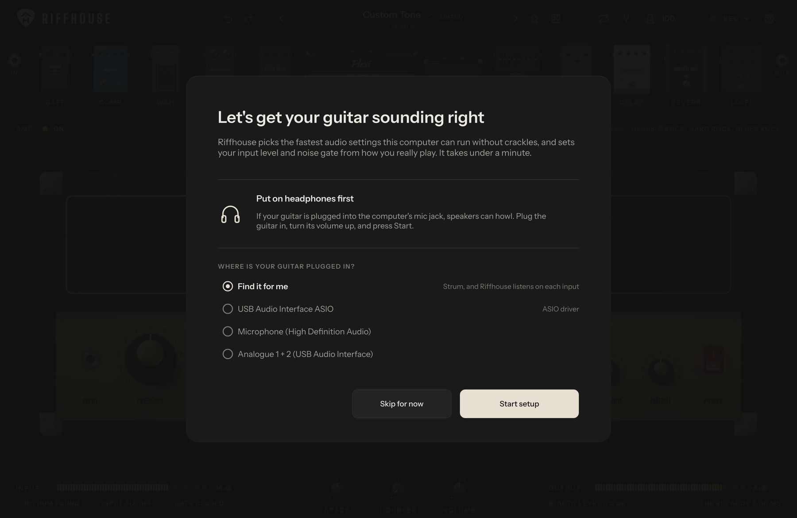

# Riffhouse

**Music should be free.** Riffhouse is a guitar amp and pedalboard for your computer: 11 amps, 29 pedals, 9 speaker cabinets and 177 tones. All of it is free, with no account, no ads and no paid version.

Plug your guitar into whatever you have, an audio interface or the mic jack on a laptop. Pick your input, play for under a minute while it sets itself up, and you have an amp.

### [Download for Windows](https://github.com/NatikChhabra/riffhouse/releases/latest)

Version 0.1.1 is the first public release. More on the [website](https://natikchhabra.github.io/riffhouse/), or go straight to [help and fixes](docs/TROUBLESHOOTING.md) and [what changed](CHANGELOG.md).


## New in 0.1.1

- **You pick the input.** Setup opens with a list of every input on the computer. Choose the one your guitar is on, or leave it on "Find it for me" and strum.
- **A choice you make stays.** A driver, input or buffer you pick by hand is tried, kept and remembered. If no sound comes through, the last working choice comes back and the screen says why.
- **Sound follows your interface.** With the guitar on an audio interface, the sound comes out of the interface too, through its own ASIO driver when it has one.
- **Heavy tones on a mic jack.** Input Fix measures the treble a mic jack takes away and puts it back, and Auto level brings every tone up as loud as the one before it.
- **Help inside the app.** Settings has **Help and fixes**, and **Report a problem**, which gathers your audio settings and device names for whoever is helping you.
- **It moves like hardware.** Switches slide, lamps warm up and die down, and the rig powers on piece by piece when setup is done. **Less motion** in Settings turns it down.

The full list is in the [changelog](CHANGELOG.md).

## Get it

**Windows:** download the file ending in `windows-setup.exe` from the [latest release](https://github.com/NatikChhabra/riffhouse/releases/latest) and run it. It installs into your own user folder, so it never asks for an administrator password.

Windows may show a blue "Windows protected your PC" box the first time. That happens because the installer is not signed with a paid certificate. Press **More info**, then **Run anyway**.

After that Riffhouse keeps itself up to date. A new version downloads in the background, its SHA-256 is checked against the one GitHub publishes for the file, and it goes in when you close the app. It never interrupts you while you play or record, and it leaves your tones and settings alone. You can switch this off in Settings.

Every older version stays on the [releases page](https://github.com/NatikChhabra/riffhouse/releases), so you can go back: run the older installer over the newer one.

**macOS and Linux:** [build it yourself](#build-it-yourself) for now.

## It sets itself up



- You pick the input your guitar is on from a list, or leave it on "Find it for me" and it listens on every input while you strum.
- With an audio interface it uses the interface's own driver when there is one, and sends the sound out of the interface too.
- It tries the fastest audio modes your computer has and keeps the lowest delay that runs without crackles.
- It asks you to play as hard as you ever will for a few seconds and sets the input level from that. If you later play harder still, the level turns itself down.
- It measures the room's noise and sets the gate just above it. The gate then follows the room, so more hiss on another day does not get through.
- **Auto level** brings every tone up as loud as the one before it, clean or heavy, measured with your own playing.
- It finds 50 or 60 Hz mains hum and removes only that.
- **Input Fix** measures how much treble a mic jack takes away from a guitar and puts it back, up to 24 dB. This is what makes heavy tones on a mic jack sound like an amp and not like a bee.
- Plug in late, pull the cable out, close the laptop lid: it reconnects by itself. If Windows swaps in another microphone, Riffhouse stays silent, because a laptop mic through an amp howls.

Something not working? [Help and fixes](docs/TROUBLESHOOTING.md) covers what people run into most.

## The gear

Every amp, pedal and cabinet is its own piece of gear, with its own face and its own knobs.

| | |
|---|---|
|  |  |
|  |  |

- **11 amps**, from glassy cleans to tight metal, plus a bass amp and a direct channel.
- **9 speaker cabinets** with a mic you can move across the cone, and a slot for your own impulse response.
- **29 pedals:** gate, compressor, wah and envelope filter, octave, seven drives and fuzzes, graphic EQ, six modulations, four delays, six reverbs and a lo-fi box.
- **177 tones** sorted by genre, with "Inspired by" tones for well-known players and songs.
- **Neural captures:** load any `.nam` file as the amp.
- **Tuner** for any tuning, and a **metronome**.
- **Undo and redo** for the whole tone, with <kbd>Ctrl</kbd>+<kbd>Z</kbd> and <kbd>Ctrl</kbd>+<kbd>Y</kbd>.
- **Drop files on the window:** a `.nam` capture becomes the amp, an impulse response the cabinet, a song the backing track, a tone file the tone.
- **Foot control:** plug in a MIDI foot controller, expression pedal or keyboard. Touch a knob or switch in Riffhouse, move the pedal, and the two are tied. Program changes pick your starred tones.
- A **VST3 plugin** of the same rig for recording software. [Riffhouse in your recording software](docs/DAW.md) gets it running.

## Record, then change your mind

Every take is saved twice: once the way you heard it, once as the clean guitar. Press <kbd>L</kbd> for your takes. **Change the tone** plays the clean guitar through the rig, so you can turn knobs or pick another tone while your own playing loops, and save the result as a new take. You played it once, you can re-amp it as often as you like.

| | |
|---|---|
|  |  |

## Practise with the song

Load a song, or drop it on the window. It plays in your headphones and never ends up in a take. Slow it down to 50 percent and the pitch stays where it was. Move it up or down a few semitones and the speed stays where it was, which helps when the record is tuned half a step down and your guitar is not. Mark the start and the end of the hard part and it goes round until you have it.

The looper is for your own playing: press <kbd>O</kbd>, play a rhythm part, press <kbd>O</kbd> again and solo over it.

| | |
|---|---|
|  |  |

## What we measure

Every change runs more than 5,900 automatic checks on the sound engine before it ships.

| | |
|---|---|
| Delay added by the rig | 5 samples, about 0.1 ms at 48 kHz |
| Amp oversampling | 8x below 64 kHz, 4x above |
| Aliasing on a hot amp | 42.9 dB below the wanted harmonics |
| Everything switched on | about 8x faster than real time on one core of a build server |
| Loudness across all 177 tones with Auto level | equal on the playing it measured with; nine in ten within about 5 dB on other playing |

## What comes next

In this order:

1. Tones for the songs players asked for first, each one showing the band and the song it is for.
2. Amps and cabinets modelled in 3D, the way the pedals already are.
3. More pedals.
4. Inputs beyond 1 and 2 on large interfaces.
5. Crash reports, off unless you switch them on.
6. A macOS build.

Missing something? [Say so](https://github.com/NatikChhabra/riffhouse/issues/new). If something is broken, **Report a problem** in Settings fills in the details for you.

## Support Riffhouse


A donation buys nothing extra, because every part is already yours.

To say thanks from India, scan the code with any UPI app, or pay `natik.chhabra@ptaxis`. It goes to Natik Chhabra, who builds Riffhouse.

From anywhere else, a star on this page helps as much.

<br clear="right">

## Share tones

A tone is a small JSON file. In the tone browser, **Copy tone code** puts the current tone on your clipboard as text, and **Paste tone code** loads one. **Open tone folder** shows where your own tones live. To add a tone to the factory set, put it in `presets/` and open a pull request.

## Build it yourself

You need CMake 3.22 or newer and a C++20 compiler. JUCE and the Neural Amp Modeler core are fetched for you.

```sh
cmake -S . -B build -DCMAKE_BUILD_TYPE=Release
cmake --build build --config Release --target Riffhouse_Standalone Riffhouse_VST3
```

On Linux install the usual JUCE packages first (ALSA, JACK, FreeType, Fontconfig, X11, Mesa). The list is in `.github/workflows/build.yml`.

On Windows, pass `-DRIFFHOUSE_ASIO_SDK_DIR=<path>` to build with ASIO. Without it you still get WASAPI exclusive mode.

Run the checks:

```sh
cmake --build build --config Release --target riffhouse_tests
build/tests/riffhouse_tests_artefacts/Release/riffhouse_tests
```

## Licence and names

Riffhouse is made by [Natik Chhabra](https://github.com/NatikChhabra). It is free software under the GNU Affero General Public License, version 3 or later.

It is built with [JUCE](https://juce.com) (AGPLv3), [Neural Amp Modeler Core](https://github.com/sdatkinson/NeuralAmpModelerCore) (MIT) and [Signalsmith Stretch](https://github.com/Signalsmith-Audio/signalsmith-stretch) (MIT), which slows the song down. Fonts: Instrument Sans, Inter, Doto, Big Shoulders, Kaushan Script and Alfa Slab One under the SIL Open Font License, and Yellowtail under the Apache License 2.0.

Every amp, pedal and cabinet in Riffhouse is an original design. Tones named "Inspired by" describe a style. Riffhouse has no affiliation with, and is not endorsed by, any artist, band or equipment maker. All trademarks belong to their owners.
